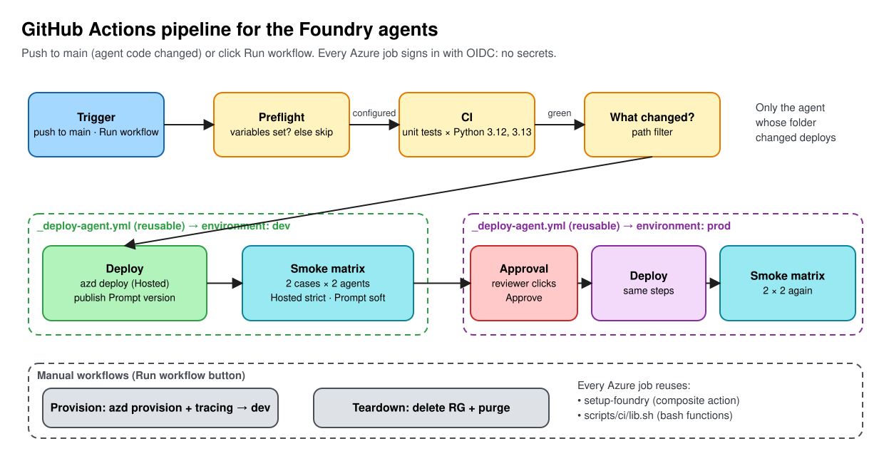
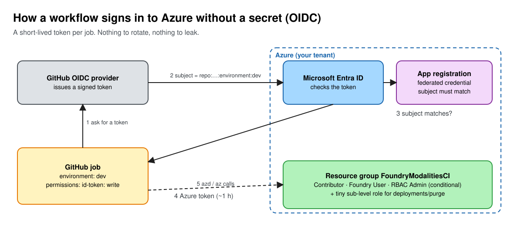

# GitHub Actions CI/CD for the Foundry agents

The Hosted Agent's big benefit is that it's **deployed from code**. This guide adds the missing piece: GitHub Actions that test, deploy, and check both agents on every change, with no secrets stored anywhere.

> New to GitHub Actions? A **workflow** is a YAML file in `.github/workflows/`. It has **jobs**; each job runs on a fresh Linux VM (a **runner**) and has **steps**. Jobs run in parallel unless one `needs:` another.

## The pipeline at a glance



1. **Trigger**: you push a change to an agent's folder on `main`, or click **Run workflow**.
2. **Preflight** checks the repo is connected to Azure. Not connected? Everything else is *skipped*, not failed.
3. **CI** runs the Python unit tests for the priority rules (no Azure needed).
4. **What changed?** decides which agent to deploy: the Hosted Agent (`deployment/**`), the Prompt Agent (`prompt_agent/instructions.md`), or both.
5. **dev**: deploy, then a **smoke-test matrix**: 2 test cases × 2 agents = 4 parallel checks.
6. **prod** waits until a reviewer clicks **Approve**, then repeats deploy + smoke tests.

Two manual workflows handle the lifecycle: **Provision** (create the Foundry project) and **Teardown** (delete it).

## The files

```text
.github/
├── actions/setup-foundry/action.yml   composite action: install azd + sign in (used by every Azure job)
└── workflows/
    ├── ci.yml              unit tests          (push, pull request, and called by cd.yml)
    ├── cd.yml              test → dev → prod   (push to main, Run workflow)
    ├── provision.yml       create Azure resources, then deploy to dev   (Run workflow)
    ├── teardown.yml        delete Azure resources                       (Run workflow)
    ├── _preflight.yml      reusable: "is this repo configured?"
    └── _deploy-agent.yml   reusable: deploy + smoke-test matrix for one environment
scripts/ci/
├── lib.sh                  all the logic, as bash functions
├── smoke-cases.json        test cases + expected answers (drives the matrix)
├── prompt_agent_ci.py      publish / invoke the Prompt Agent
└── setup-github-oidc.sh|.ps1   one-time setup for your fork
```

Files starting with `_` are building blocks, never run on their own.

### YAML says *what*, `lib.sh` says *how*

Every step is one line that calls one function:

```yaml
- name: Invoke and assert (${{ matrix.mode }})
  run: ./scripts/ci/lib.sh smoke_test ${{ matrix.agent }} ${{ matrix.case }} ${{ matrix.mode }}
```

| Function | Does |
|---|---|
| `preflight` | Checks the 6 repository variables; writes `configured=true/false` |
| `provision` | `azd provision`, then `connect_tracing` |
| `connect_tracing` | Log Analytics + Application Insights + project connection (idempotent) |
| `deploy_hosted` | `azd deploy` the Hosted Agent, then `azd ai agent show` |
| `publish_prompt` | New Prompt Agent version **only if** `instructions.md` changed |
| `smoke_test` | Invoke one agent with one case, check priority/score/reason codes |
| `teardown` | Delete the resource group, purge soft-deleted resources |

You can run them on your laptop too (Git Bash, macOS, Linux): `./scripts/ci/lib.sh case_prompt contoso-30min-outage`.

## Three identities, three jobs

| Identity | Who | Used for |
|---|---|---|
| **You** | your Entra user (e.g. `you@contoso.com`) | Run the one-time setup script; approve prod |
| **CI service principal** | app registration `gh-<owner>-<repo>-foundry-ci` | Everything the workflows do in Azure. Signs in with OIDC (below) |
| **Agent identity** | created by Foundry for the Hosted Agent (blueprint + instance) | The running agent calling the model. `azd deploy` gives it **Foundry User** |

## How a workflow signs in without a secret (OIDC)



1. The job has `permissions: id-token: write`, so it may ask GitHub for a token.
2. GitHub signs a short-lived token. Its **subject** says exactly who is asking, e.g. `repo:<owner>@<id>/<repo>@<id>:environment:dev`.
3. `azure/login` sends it to Microsoft Entra ID, which looks for a **federated credential** on the app registration with the same subject.
4. Match → Entra returns an Azure access token (about 1 hour). No match → `AADSTS700213`.
5. `az` and `azd` use that token. What they may do is decided by **role assignments** (next section).

There's no client secret to store, rotate, or leak. The setup script creates one federated credential per subject: `environment:dev`, `environment:prod`, `ref:refs/heads/main`.

> **New in 2026:** for new repos, GitHub puts **immutable IDs** in the subject (`octocat@123456/hello-world@456789`) so a renamed or re-created repo can't inherit your trust. The setup script asks GitHub for the exact prefix (`GET /repos/{repo}/actions/oidc/customization/sub` → `sub_claim_prefix`). See [GitHub changelog](https://github.blog/changelog/2026-04-23-immutable-subject-claims-for-github-actions-oidc-tokens/).

## Permissions: least privilege

The CI principal gets roles on **one resource group**, plus one tiny subscription-level custom role.

| Role | Scope | Why |
|---|---|---|
| **Contributor** | resource group | Create the Foundry account, project, model deployment, Log Analytics, App Insights, project connection |
| **Foundry User** (formerly Azure AI User) | resource group | Data plane: create agent versions, invoke agents |
| **Role Based Access Control Administrator**, *with a condition* | resource group | `azd deploy` grants **Foundry User** to the Hosted Agent's identity. The [ABAC condition](https://learn.microsoft.com/azure/role-based-access-control/delegate-role-assignments-overview) allows assigning **only that one role**, so the principal can't make itself Owner |
| **Foundry CI subscription deployer** (custom) | subscription | Only `Microsoft.Resources/deployments/*`, read subscription/resource groups, and purge soft-deleted Foundry accounts. Needed because azd's Foundry provider runs a *subscription-scope* ARM deployment (it can create the resource group). ARM still checks every resource inside against the resource-group roles, so this doesn't widen what can be created |

Not granted: Owner, User Access Administrator, subscription-wide Contributor.

> **Why not `azd pipeline config`?** It does the same OIDC setup in one command, but grants **Contributor + User Access Administrator on the whole subscription** and creates branch-only federated credentials (no environments). Our script is the least-privilege version of the same thing.

## GitHub Actions features used, and why

| Feature | Where | Why we used it |
|---|---|---|
| **OIDC** (`id-token: write` + `azure/login`) | every Azure job | No secrets in GitHub. Tokens last ~1 hour and only work for matching subjects |
| **Composite action** | `.github/actions/setup-foundry` | 6 setup steps written once, reused by 4 job types. Change azd setup in one place |
| **Reusable workflow** (`workflow_call`) | `_deploy-agent.yml`, `_preflight.yml`, `ci.yml` | Deploy + test logic written once; called for dev, prod and after Provision. CD reuses CI so nothing deploys untested |
| **Matrix** | `ci.yml`, `_deploy-agent.yml` | One job definition → many parallel jobs. CI: Python 3.12 × 3.13. Smoke: 2 cases × 2 agents |
| **Dynamic matrix** (`fromJSON`) | `_deploy-agent.yml` `plan` job | Test cases come from `smoke-cases.json`. Add a case to the file; a new matrix leg appears. No YAML edit |
| **`matrix.include`** | `_deploy-agent.yml` | Attaches `mode: strict` to hosted legs and `mode: soft` to prompt legs |
| **`fail-fast: false`** | both matrices | See every failing leg, not just the first |
| **Environments + required reviewer** | `dev`, `prod` | `prod` pauses until `lenvolk` approves. Both point at the **same** Foundry project here (no extra cost); in real life prod is a separate project |
| **Concurrency** | all workflows | CI: newer commit **cancels** older run (saves minutes). Azure workflows share group `foundry-<env>` with `cancel-in-progress: false`: never two deploys at once, never killed halfway |
| **Path filters** (`on.push.paths`) | `ci.yml`, `cd.yml` | Docs-only commits don't run CD |
| **Job-level change detection** (`dorny/paths-filter`) | `cd.yml` | Finer than path filters: deploy *only* the agent whose folder changed |
| **YAML anchors** (`&code` / `*code`) | `ci.yml` | Same path list for `push` and `pull_request`, written once |
| **Conditional jobs** (`if:`) + job outputs | preflight → everything | `configured == 'false'` turns jobs grey (skipped) instead of red |
| **`workflow_dispatch` inputs** | Provision, Teardown | A checkbox (deploy after provisioning) and a typed confirmation (resource group name) |
| **Step summary** (`$GITHUB_STEP_SUMMARY`) | `lib.sh summary` | Markdown tables on the run page: what was deployed, which checks passed, the agent's answer |
| **Annotations** (`::error::`, `::warning::`, `::notice::`) | `lib.sh` | Messages appear at the top of the run, not buried in logs |
| **`::add-mask::`** | `connect_tracing` | Hides the App Insights connection string in logs |
| **pip cache** (`setup-python` `cache: pip`) | setup-foundry | Prompt Agent SDK installs from cache on later runs |
| **`permissions:`** | every workflow | Default is read-only `contents: read`; only Azure jobs get `id-token: write` |
| **SHA-pinned actions** | everywhere | `uses: actions/checkout@3d3c42e…  # v7.0.1`. A tag can be moved; a commit SHA can't. Dependabot can still update them |
| **Sparse checkout** | preflight, plan | Fetch only `scripts/ci`: faster for tiny jobs |
| **Inputs via `env:`** | Teardown | Never put `${{ inputs.x }}` inside `run:`; it allows script injection |

## Strict vs soft smoke tests: the lesson

`smoke-cases.json` has two cases:

| Case | Expected | Reason codes |
|---|---|---|
| `contoso-95min-outage` | **P0**, score **8** | `OUTAGE_60` `STRATEGIC_CONTRACT` `REGULATED_IMPACT` `RENEWAL_30` |
| `contoso-30min-outage` | **P1**, score **5** | same minus `OUTAGE_60` |

- **Hosted Agent → strict.** Python computes the answer. A wrong answer is a bug: the job fails.
- **Prompt Agent → soft.** The model does the math from English instructions. It's usually right, not guaranteed. A mismatch is a yellow `::warning::` and a note in the summary, not a failure.

That's the demo's point, now visible in CI: **code you own is testable; instructions are guidance.**

## Use it in your fork

### Checklist

- [ ] Fork this repo, clone your fork.
- [ ] You're **Owner** (or User Access Administrator + Contributor) on an Azure subscription.
- [ ] Model quota: ≥ 10 units of `gpt-5.6-sol` GlobalStandard in your region ([ai-deployment.md § 4](ai-deployment.md#4-check-model-quota)).
- [ ] Tools: Azure CLI, GitHub CLI (`gh auth login`), PowerShell 7 *or* bash.
- [ ] Run the setup script (below).
- [ ] **Actions → Provision → Run workflow.**

### Variables the workflows read

Settings → Secrets and variables → Actions → **Variables**. None are secrets: IDs identify things, they don't grant access (OIDC + roles do). They do show up in job logs, so don't use a public fork if that bothers you.

| Variable | What it is | Where to get it | Example |
|---|---|---|---|
| `AZURE_CLIENT_ID` | CI app registration's client ID | setup script output, or Entra ID → App registrations | `00000000-0000-0000-0000-000000000000` |
| `AZURE_TENANT_ID` | Your Entra tenant | `az account show --query tenantId -o tsv` | `00000000-…` |
| `AZURE_SUBSCRIPTION_ID` | Subscription to deploy into | `az account show --query id -o tsv` | `00000000-…` |
| `AZURE_RESOURCE_GROUP` | Resource group (created by the script) | you choose | `FoundryModalitiesCI` |
| `AZURE_LOCATION` | Region with model quota | you choose | `northcentralus` |
| `AZURE_ENV_NAME` | azd environment = Foundry project name | you choose | `foundry-modalities-ci` |
| `AZURE_AI_MODEL_DEPLOYMENT_NAME` | Optional. Model deployment name | `deployment/azure.yaml` | `gpt-5.6-sol` |

Preflight behaviour:

| You set | Result |
|---|---|
| nothing | Green run, Azure jobs **skipped**, notice links here |
| some | Red run listing exactly which variables are missing |
| all | Azure jobs run |

### Run the setup script (once)

```powershell
az login --tenant <TENANT_ID>
./scripts/ci/setup-github-oidc.ps1 -GitHubRepo <you>/foundry-agent-modalities-demo
```

```bash
az login --tenant <TENANT_ID>
GITHUB_REPO=<you>/foundry-agent-modalities-demo ./scripts/ci/setup-github-oidc.sh
# Git Bash on Windows: prefix with MSYS_NO_PATHCONV=1
```

It asks for anything missing, then creates: resource group → app registration + service principal → 3 federated credentials → custom role → 4 role assignments → 7 GitHub variables → environments `dev` and `prod` (you as reviewer). Re-running it is safe: existing items show `✓`.

<details>
<summary>What the script does, by hand (az + gh)</summary>

```bash
RG=FoundryModalitiesCI; LOC=northcentralus; REPO=<you>/foundry-agent-modalities-demo
SUB=$(az account show --query id -o tsv)

az group create -n $RG -l $LOC
APP_ID=$(az ad app create --display-name gh-foundry-ci --query appId -o tsv)
SP_ID=$(az ad sp create --id $APP_ID --query id -o tsv)

PREFIX=$(gh api repos/$REPO/actions/oidc/customization/sub -q .sub_claim_prefix)   # repo:owner@id/name@id
for S in environment:dev environment:prod ref:refs/heads/main; do
  az ad app federated-credential create --id $APP_ID --parameters \
    "{\"name\":\"gh-${S//[:\/]/-}\",\"issuer\":\"https://token.actions.githubusercontent.com\",\"subject\":\"$PREFIX:$S\",\"audiences\":[\"api://AzureADTokenExchange\"]}"
done

RG_ID=/subscriptions/$SUB/resourceGroups/$RG
az role assignment create --assignee-object-id $SP_ID --assignee-principal-type ServicePrincipal --role Contributor --scope $RG_ID
az role assignment create --assignee-object-id $SP_ID --assignee-principal-type ServicePrincipal --role 53ca6127-db72-4b80-b1b0-d745d6d5456d --scope $RG_ID   # Foundry User
az role assignment create --assignee-object-id $SP_ID --assignee-principal-type ServicePrincipal --role f58310d9-a9f6-439a-9e8d-f62e7b41a168 --scope $RG_ID \
  --condition-version 2.0 --condition "<only role 53ca6127…; see the script>"
az role definition create --role-definition @role.json      # "Foundry CI subscription deployer", see the script
az role assignment create --assignee-object-id $SP_ID --assignee-principal-type ServicePrincipal --role "Foundry CI subscription deployer" --scope /subscriptions/$SUB

gh variable set AZURE_CLIENT_ID -b $APP_ID -R $REPO      # …and the other 6 variables
gh api -X PUT repos/$REPO/environments/dev
gh api -X PUT repos/$REPO/environments/prod --input - <<<'{"reviewers":[{"type":"User","id":<your-user-id>}]}'
```

</details>

## Run each workflow

| Workflow | How | Takes | You'll see |
|---|---|---|---|
| **CI** | any push / PR touching agent code, scripts, or workflows | ~30 s | 2 unit-test legs + script checks |
| **Provision** | Actions → Provision → Run workflow (☑ deploy) | ~10 min | Resource table, then a full dev deploy + 4 smoke legs |
| **CD** | push to `main` changing `deployment/**` or `prompt_agent/**`, or Run workflow (deploys both) | ~10 min + approval | dev → **Review deployments** button → prod |
| **Teardown** | Actions → Teardown → Run workflow, type the resource group name | ~5 min | "Torn down" summary |

Approve prod: open the run → **Review deployments** → tick `prod` → **Approve and deploy**.

Try it: change `if outage_minutes >= 60` to `>= 30` in `priority_rules.py` and push. The unit tests still pass (none uses a 30-minute outage), the Hosted Agent deploys to dev, and the **strict** `hosted × contoso-30min-outage` leg fails because the answer is now P0. Prod never gets an approval request. That's the smoke test catching a policy change the unit tests missed.

Both agents are **idempotent**: deploying the same thing twice doesn't create a new version. `azd deploy` compares the Hosted Agent's code hash (`content_hash`) and keeps the existing version when nothing changed. `prompt_agent_ci.py` does the same for the Prompt Agent: it stores a hash of `instructions.md` + model, plus the git SHA, in the version's metadata. That's why prod (same project here) reports *Unchanged* after dev already deployed.

## After Teardown

Teardown deletes the resource group, so its role assignments go too. The app registration, federated credentials, GitHub variables, and environments stay. Before the next Provision, re-run the setup script (≈1 min); it recreates the resource group and the 3 resource-group role assignments.

## Troubleshooting

| Symptom | Cause → fix |
|---|---|
| Run is green but Azure jobs are grey | Preflight found no variables. Run the setup script |
| Preflight red: `X is not set` | Add the listed variables (table above) |
| `AADSTS700213: No matching federated identity record` | Subject mismatch. Compare the subject in the error with `az ad app federated-credential list --id <client-id>`. Re-run the setup script (it reads GitHub's exact prefix) |
| `AuthorizationFailed … Microsoft.Resources/deployments/write` at subscription | Custom role missing. Re-run the setup script |
| `AuthorizationFailed` on the resource group after Teardown | Role assignments were deleted with the RG. Re-run the setup script |
| `No Foundry project … Run the 'Provision' workflow first` | CD ran before Provision, or after Teardown |
| prod stuck on *Waiting* | Someone must approve it (Review deployments) |
| A second run says *Pending* | Concurrency: it waits for the running deploy to finish |
| Prompt leg yellow ⚠️ | Expected sometimes: the model's math isn't guaranteed. Read the response in the summary |
| Hosted leg red ❌ | Real regression. The summary shows which check failed and the full answer |
| `InsufficientQuota` during Provision | Pick another region or model ([ai-deployment.md § 4](ai-deployment.md#4-check-model-quota)) |
| `failed to download artifact … 504` installing the azd extension | Transient. `setup-foundry` retries 3×; if all fail, **Re-run failed jobs** |

## Cost

Provision creates the same billable resources as [ai-deployment.md](ai-deployment.md): model calls, Hosted Agent sessions, trace ingestion. A full CD run sends 8 smoke-test requests (4 legs × dev/prod). Run **Teardown** when you're done.

## References

- [Set up CI/CD for a hosted agent (azd)](https://learn.microsoft.com/azure/foundry/agents/quickstarts/set-up-cicd-hosted-agent?pivots=azd): the official starting point this pipeline extends
- [Use the Azure login action with OpenID Connect](https://learn.microsoft.com/azure/developer/github/connect-from-azure-openid-connect)
- [Reusing workflows](https://docs.github.com/actions/sharing-automations/reusing-workflows) · [Creating a composite action](https://docs.github.com/actions/sharing-automations/creating-actions/creating-a-composite-action) · [Using environments for deployment](https://docs.github.com/actions/managing-workflow-runs-and-deployments/managing-deployments/managing-environments-for-deployment)
- Diagrams: [`docs/diagrams/gh-actions-pipeline.excalidraw`](docs/diagrams/gh-actions-pipeline.excalidraw), [`docs/diagrams/gh-actions-oidc.excalidraw`](docs/diagrams/gh-actions-oidc.excalidraw)
